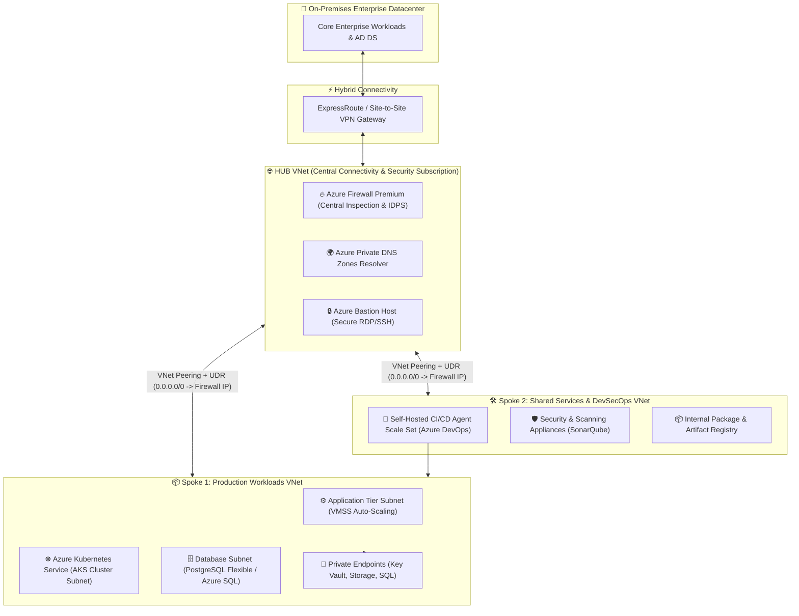
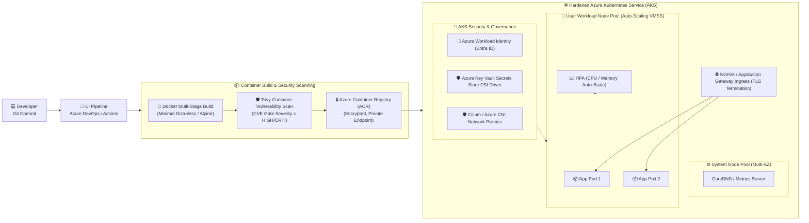
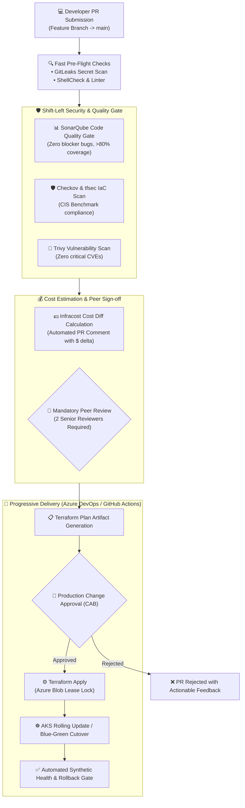
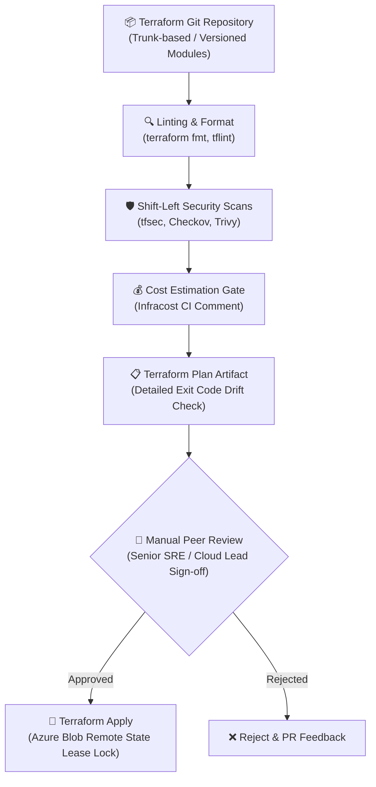
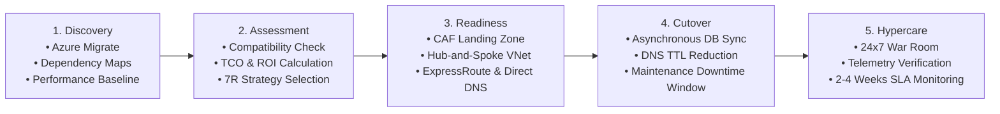

<div align="center">

<!-- Animated Header Wave Banner with Glowing Highlighted Name -->


<!-- Animated Glowing Cyber Laser Divider -->


<br/>

# 👋 Hi there, I'm <mark style="background: linear-gradient(120deg, #0078D4 0%, #00C7B7 100%); color: white; padding: 4px 18px; border-radius: 8px; font-weight: 800; display: inline-block;">Neetu Patel</mark> 

### 🚀 **DevOps Engineer | Azure Cloud | Terraform | Docker | Kubernetes | Azure DevOps | CI/CD | Git | Linux | Infrastructure as Code (IaC) | Cloud Automation**

[+with+Terraform+%26+Terragrunt;Container+Orchestration+with+Kubernetes+(AKS)+%26+Docker;Enterprise+CI%2FCD+Automation+with+Azure+DevOps+%26+GitHub+Actions;Cloud+Automation+%26+Linux+Systems+Engineering;Migrated+100%2B+Enterprise+Workloads+with+Zero+Downtime;Zero-Trust+DevSecOps+%7C+100%25+CIS+Benchmark+Compliance;FinOps+Leader+%7C+%241.2M%2B+Cloud+OpEx+Saved+(28%25))](https://git.io/typing-svg)

<p align="center">
  <a href="https://linkedin.com/in/"></a>
  <a href="mailto:patel.neetu10@gmail.com"></a>
  <a href="https://github.com/patelneetu10-stack"></a>
  <a href="#"></a>
  <a href="#"></a>
  <a href="#"></a>
</p>

<!-- Quick Navigation Bar -->
<p align="center">
  <a href="#-core-architecture-pillars--mission"><b>Core Pillars</b></a> •
  <a href="#-executive-summary--philosophy-"><b>Executive Summary</b></a> •
  <a href="#-quantified-enterprise-business-impact"><b>Impact Metrics</b></a> •
  <a href="#-enterprise-technical-arsenal"><b>Tech Stack</b></a> •
  <a href="#1-enterprise-azure-hub-and-spoke-landing-zone-architecture"><b>Hub & Spoke</b></a> •
  <a href="#2-production-kubernetes-aks--docker-container-ecosystem"><b>Kubernetes & Docker</b></a> •
  <a href="#3-enterprise-devsecops-cicd-pipeline-flow"><b>CI/CD Pipeline</b></a> •
  <a href="#4-production-grade-terraform-landing-zone--drift-automation"><b>Terraform IaC</b></a> •
  <a href="#5-multi-layered-defense-in-depth-cloud-security-matrix"><b>DevSecOps Matrix</b></a> •
  <a href="#6-finops-cloud-financial-management--economics-framework"><b>FinOps</b></a> •
  <a href="#7-real-world-architecture-100-enterprise-workload-migration"><b>Migration Playbook</b></a> •
  <a href="#-live-github-analytics--activity"><b>GitHub Stats</b></a>
</p>

---

### 🌐 *"Bridging Resilient Cloud Architecture, Immutable Infrastructure as Code, High-Speed CI/CD & Zero-Trust DevSecOps"*

</div>

<br/>

## 📌 Core Architecture Pillars & Mission

> *"Building Secure, Highly Scalable, Self-Healing & Automated Cloud Infrastructure with Azure, Terraform, Docker, Kubernetes and Enterprise CI/CD."*

- ☁️ **Azure Cloud & Landing Zones:** Architecting enterprise-scale Microsoft Cloud Adoption Framework (CAF) Landing Zones, Hub-and-Spoke networks, ExpressRoute/VPN gateways, and private endpoint perimeters with 99.99% availability.
- ⚙️ **Infrastructure as Code (IaC):** 100% declarative, modular Terraform & Terragrunt with remote state locking in Azure Blob storage, state encryption, and automated nightly drift detection.
- ☸️ **Containers & Orchestration (Docker & AKS):** Production-grade containerization with Docker multi-stage builds, Azure Kubernetes Service (AKS), Helm charts, horizontal/vertical auto-scaling (HPA/VPA), and ingress controllers.
- 🔄 **Enterprise CI/CD Automation:** Robust multi-stage deployment pipelines in Azure DevOps and GitHub Actions featuring trunk-based branching, environment gates, branch protection policies, and automated zero-downtime rollouts.
- 🔒 **Zero-Trust DevSecOps:** Shift-left security integrated directly into PR pipelines: Checkov/tfsec for IaC scanning, Trivy for container vulnerability scanning, GitLeaks for secret detection, and CIS Azure Benchmarks.
- 🐧 **Linux & System Automation:** Expert Linux systems engineering (RHEL, Ubuntu), shell scripting (Bash, PowerShell), Python automation, and automated VM baseline configuration via Cloud-Init.
- 💰 **FinOps & Cloud Economics:** Automated cost optimization, resource rightsizing, Azure Reservations/Savings Plans, and Infracost CI/CD budget guardrails saving over 28% in annualized cloud spend.

---

## 👨‍💼 Executive Summary & Philosophy 

With **5+ years of battle-tested enterprise experience**, I specialize in designing, automating, and maintaining mission-critical cloud platforms on **Microsoft Azure**, orchestrated via **Terraform**, containerized with **Docker**, scaled on **Kubernetes (AKS)**, and delivered through automated **Azure DevOps and GitHub Actions CI/CD pipelines**.

I believe modern DevOps is not merely about stitching scripts together—it is about **engineering deterministic, resilient, self-healing platforms that empower engineering teams to deploy software rapidly and securely with zero friction and zero downtime**.

From orchestrating the lift-and-shift and modernization of **100+ enterprise workloads to Azure**, to writing hardened, re-usable Terraform modules and designing bank-grade network isolation with Azure Firewall Premium and Private Endpoints, I ensure that cloud infrastructure remains **immutable, auditable, cost-efficient, and secure by design**.

```
                                [ The Senior DevOps Mindset ]
                                              │
                         "Automate, Secure, Observe & Scale Reliably"
                                              │
         ┌────────────────────────────────────┼────────────────────────────────────┐
         │                                    │                                    │
 [ Infrastructure as Code ]          [ Cloud Platform & AKS ]              [ CI/CD & DevSecOps ]
  • Terraform Modular Blueprints      • Azure CAF Landing Zones             • Multi-Stage Azure Pipelines
  • Remote State Blob Lease Locking   • Hub-and-Spoke Microsegmentation     • Shift-Left Security (Trivy/Checkov)
  • Nightly Drift Detection Jobs      • AKS Production Clusters & Helm      • Automated Rollback Runbooks
  • Infracost FinOps CI Gates         • Docker Multi-Stage Optimization     • Branch Policies & CODEOWNERS
```

---

## 📈 Quantified Enterprise Business Impact

<table align="center" width="100%">
  <tr>
    <td align="center" width="16%">
      <h3>🚀 100+ Workloads</h3>
      <p><b>Cloud Migration</b><br/>Zero-downtime cutover from On-Premises datacenters to Azure Landing Zones.</p>
    </td>
    <td align="center" width="16%">
      <h3>☸️ 99.99% Uptime</h3>
      <p><b>AKS & Compute SRE</b><br/>Multi-AZ node pools, auto-healing VMSS, and automated disaster recovery (RTO &lt; 15m).</p>
    </td>
    <td align="center" width="16%">
      <h3>💰 28% OpEx Saved</h3>
      <p><b>FinOps Governance</b><br/><b>$1.2M+</b> annual reduction via rightsizing, RI/Savings Plans & automated scheduling.</p>
    </td>
    <td align="center" width="16%">
      <h3>🛡️ 100% Compliance</h3>
      <p><b>Zero-Trust Security</b><br/>Automated CIS Azure Benchmarks, PIM/JIT, secret scanning, and vulnerability gates.</p>
    </td>
    <td align="center" width="16%">
      <h3>🔄 90% Faster Deploy</h3>
      <p><b>Automated CI/CD</b><br/>Lead time reduced from days to minutes with self-hosted runners & parallel pipeline stages.</p>
    </td>
    <td align="center" width="16%">
      <h3>⚙️ 100% IaC</h3>
      <p><b>Zero Drift Infrastructure</b><br/>All resources defined in version-controlled Terraform modules with state lease locks.</p>
    </td>
  </tr>
</table>

---

## 🛠️ Enterprise Technical Arsenal

<div align="center">

| Domain | Core Technologies & Enterprise Competencies |
| :--- | :--- |
| **Cloud Platforms & Networking** |      `Cloud Adoption Framework (CAF)` `ExpressRoute` `UDR Routing` `NAT Gateway` |
| **Infrastructure as Code (IaC)** |     `Modular Architecture` `Azure Blob Remote State Locking` `Nightly Drift Detection` |
| **Containers & Orchestration** | -326CE5?style=flat-square&logo=kubernetes&logoColor=white)     `HPA / VPA` `Cilium eBPF` `Workload Identity` `Ingress Controller` |
| **CI/CD & GitOps Automation** |    `Multi-Stage YAML` `Branch Policies` `Approvals Gate` `Self-Hosted Scale Set Runners` |
| **DevSecOps & Governance** |      `Microsoft Defender for Cloud` `PIM/JIT` `Entra ID` `Azure Policy` |
| **Operating Systems & Scripting** |      `Cloud-Init` `Systemd` `Kernel Tuning` |
| **Version Control & Collaboration** |   `Trunk-Based Development` `Branch Policies` `Strict PR Gates` `Semantic Versioning` |
| **Observability, SRE & Logging** |  -0078D4?style=flat-square)    |
| **FinOps & Cloud Economics** |   `FinOps Foundation Principles` `Reserved Instances` `Savings Plans` `Cost Allocation Tags` |

</div>

---

## 🏛️ Enterprise Architecture Blueprints & Production Playbooks

### 1. Enterprise Azure Hub-and-Spoke Landing Zone Architecture

Centralized egress/ingress inspection, zero overlapping CIDR blocks, forced tunneling (`0.0.0.0/0`), and strict private link connectivity for enterprise workloads.



> **Key Networking Engineering Highlights:**
> - **IP Address Management (IPAM):** Non-overlapping RFC 1918 CIDR allocation across on-premises data centers and cloud landing zones.
> - **Zero-Trust Egress/Ingress:** All outbound internet traffic routed via User Defined Routes (`0.0.0.0/0`) through Azure Firewall with SNAT, FQDN filtering, and TLS inspection.
> - **Private PaaS Isolation:** PaaS services (Key Vault, Storage Accounts, Azure SQL, Redis) communicate exclusively over Private Endpoints without public IPs.

---

### 2. Production Kubernetes (AKS) & Docker Container Ecosystem

Production-hardened Azure Kubernetes Service (AKS) platform orchestrated with Docker multi-stage builds, Helm packaging, and GitOps delivery.



> **Kubernetes & Docker Engineering Standards:**
> - **Multi-Stage Dockerfiles:** Building lightweight, distroless/alpine production images; eliminating build tools from final images to shrink attack surfaces by 80%.
> - **Zero Plaintext Secrets:** CSI Secrets Store driver mounts secrets directly from Azure Key Vault as ephemeral in-memory volumes with auto-rotation.
> - **Azure Workload Identity:** Eliminating long-lived Kubernetes Service Account tokens; pods authenticate to Azure APIs via short-lived OIDC federated tokens.
> - **Microsegmentation with Network Policies:** Default deny-all ingress/egress rules allowing only explicitly whitelisted inter-service communications.

---

### 3. Enterprise DevSecOps CI/CD Pipeline Flow

Deterministic, shift-left multi-stage deployment pipeline spanning pull request validation, automated security gates, and continuous delivery.



> **Pipeline Governance Highlights:**
> - **Branch Protection:** Strict trunk-based branching with `main` branch locked; zero direct commits, mandatory PR approvals, and passing status checks.
> - **Shift-Left Security:** Builds fail fast before any infrastructure is provisioned if unencrypted storage, open NSG ports, or exposed credentials are detected.
> - **Automated Rollbacks:** Pipelines continuously query health probes post-deployment; if latency or error rates spike, automated rollback runbooks trigger immediately.

---

### 4. Production-Grade Terraform Landing Zone & Drift Automation

Standardized, modular, and drift-resistant Infrastructure as Code delivery.



> **IaC Enterprise Standards:**
> - **Remote State Security:** Stored in isolated, encrypted Azure Storage Accounts with Blob Lease Locking and Managed Identity auth (zero plaintext credentials).
> - **Strict Modularity:** Parameterized modules published to private registries with semantic versioning (`v1.2.0`).
> - **Nightly Drift Detection Pipelines:** Scheduled unattended pipelines running `terraform plan -detailed-exitcode` to immediately detect out-of-band portal alterations and trigger alerts.

---

### 5. Multi-Layered Defense-in-Depth Cloud Security Matrix

| Layer | Key Technologies | Hardening Controls & Architecture Implemented |
| :--- | :--- | :--- |
| **1. Identity & Access** | Microsoft Entra ID, PIM, Conditional Access | Mandatory phishing-resistant MFA, Just-In-Time role activation, User-Assigned Managed Identities, zero long-lived credentials. |
| **2. Perimeter & Network** | Azure Firewall Premium, NSGs, ASGs | Micro-segmentation, TLS inspection, IDPS (Intrusion Detection/Prevention), Private Endpoints, DDoS Protection Standard. |
| **3. Governance & Policy** | Azure Policy, CIS Benchmark, MCSB | Continuous compliance scanning, automated deny/remediation policies, Defender for Cloud Secure Score tracking (>85%). |
| **4. Compute & Host** | Defender for Servers, Qualys, Disk Encryption | Automated vulnerability scanning, OS baseline patch enforcement, Disk Encryption Sets with Customer-Managed Keys (CMK) in HSM Key Vault. |
| **5. Container Security** | Docker, AKS, Trivy, ACR, Cilium | Distroless container images, read-only root filesystems, non-root user execution, eBPF network filtering, container vulnerability scanning in CI/CD. |

---

### 6. FinOps (Cloud Financial Management & Economics) Framework

```
                          [ FinOps Enterprise Engine ]
                                       │
     ┌──────────────────┬──────────────┴─────┬──────────────────┐
     ▼                  ▼                    ▼                  ▼
[ Eliminate Waste ] [ Rightsizing ] [ Commitments ]    [ Telemetry Tuning ]
 • Unattached Disks  • 30-Day P95    • 1/3-Yr RIs       • DCR Log Filters
 • Orphaned IPs      • CPU/Mem Curve • Savings Plans    • Basic vs Analytics
 • Stale Snapshots   • Auto-Scaling  • Spot Instances   • Ingestion Caps
```

- **Waste Elimination:** Automated cron jobs identifying and purging unattached managed disks, orphaned snapshots, and unused public IPs.
- **Rightsizing:** Resizing underutilized VMs and databases based on 30-day 95th percentile CPU/RAM metrics.
- **Commitment Optimization:** Utilizing Azure Reservations and Savings Plans for steady-state workloads (up to 72% cost savings).
- **Automated Scheduling:** Automated start/stop runbooks for non-production environments outside business operating hours (saving ~65% non-prod compute).
- **Log Ingestion Tuning:** Configuring Data Collection Rules (DCR) in Azure Monitor Agent to drop noisy, non-critical telemetry before billing ingestion.

---

### 7. Real-World Architecture: 100+ Enterprise Workload Migration

A production-proven framework for modernizing and migrating 100+ mission-critical workloads from on-premises VMware/Hyper-V environments to Azure.



#### 🛡️ The 10 Scalability & Quality Architecture Pillars
1. **Scalable:** Auto-scaling VMSS, AKS node pools, and database elastic pools.
2. **Robust:** Decoupled asynchronous event queues (Azure Service Bus) absorbing traffic spikes.
3. **Secure:** Zero-Trust identity, micro-segmented NSGs/ASGs, and encrypted data at rest/in transit.
4. **Reliable:** Circuit breakers, health probes, automated self-healing, and zone redundancy.
5. **Portable:** Containerized standard microservices with declarative IaC.
6. **Governed:** Automated policy guardrails preventing non-compliant resource provisioning.
7. **High Availability:** Active-active multi-region/multi-zone architectures delivering 99.99% SLA.
8. **Cost-Optimized:** Continuous FinOps rightsizing, automated off-hour shutdowns, and Reservations.
9. **Backed Up:** Immutable, air-gapped Azure Recovery Services vaults with soft-delete enabled.
10. **Compliant & Monitored:** Centralized Log Analytics, AMA agent telemetry, and automated audit trails.

---

### 8. Backup, Disaster Recovery & High Availability (SRE)

- **Storage Redundancy:**
  - **LRS (Locally Redundant Storage):** 3 synchronous copies within a single datacenter for transient workloads.
  - **ZRS (Zone-Redundant Storage):** Synchronous replication across 3 physical availability zones in a region for mission-critical apps.
  - **GRS (Geo-Redundant Storage):** Asynchronous replication to a secondary paired region for disaster recovery resilience.
- **High Availability Compute:** Virtual Machine Scale Sets (VMSS) orchestrated across multiple Availability Zones with automated health probes.
- **Business Continuity Metrics:**
  - **RTO (Recovery Time Objective):** `< 15 Minutes` using automated Azure Site Recovery (ASR) orchestration runbooks.
  - **RPO (Recovery Point Objective):** `< 5 Minutes` through continuous transactional log shipping and geo-replication.

---

### 9. Enterprise Observability & SRE Incident Management

- **Centralized Telemetry:** Enterprise-wide Log Analytics Workspaces partitioned by environment and regulatory domain.
- **Azure Monitor Agent (AMA):** Source-level log filtering using custom KQL in Data Collection Rules (DCR).
- **Dynamic Alert Routing:** Action Groups integrated directly with Microsoft Teams, Slack, and PagerDuty with auto-escalation policies.

---

## 📊 Live GitHub Analytics & Activity

<div align="center">


<br/><br/>


</div>

---

## 🌟 Featured Enterprise Architecture Repositories

<table width="100%">
  <tr>
    <td width="50%" valign="top">
      <h3>🏛️ <a href="https://github.com/patelneetu10-stack/azure-landing-zone">azure-landing-zone</a></h3>
      <p>Production Azure Cloud Adoption Framework (CAF) Hub-and-Spoke Landing Zone with Azure Firewall Premium, Bastion, UDR forced tunneling, and Zero-Trust network governance.</p>
      <p>
        
        
        
      </p>
    </td>
    <td width="50%" valign="top">
      <h3>☸️ <a href="https://github.com/patelneetu10-stack/aks-cluster-infra">aks-cluster-infra</a></h3>
      <p>Hardened Azure Kubernetes Service (AKS) platform with Cilium eBPF network policies, Azure Workload Identity, Key Vault CSI auto-rotating secrets, and ACR integration.</p>
      <p>
        
        
        
      </p>
    </td>
  </tr>
  <tr>
    <td width="50%" valign="top">
      <h3>🏥 <a href="https://github.com/patelneetu10-stack/healthcare-platform-infra">healthcare-platform-infra</a></h3>
      <p>HIPAA / HITRUST-compliant healthcare infrastructure on Azure with zone-redundant PostgreSQL Flexible Server (CMK encryption), HSM Key Vault, and 730-day WORM immutable storage.</p>
      <p>
        
        
        
      </p>
    </td>
    <td width="50%" valign="top">
      <h3>⚙️ <a href="https://github.com/patelneetu10-stack/platform-infrastructure-prod">platform-infrastructure-prod</a></h3>
      <p>Multi-tier production shared services platform featuring Azure NAT Gateway with deterministic static egress, Redis distributed caching, and automated nightly drift detection.</p>
      <p>
        
        
        
      </p>
    </td>
  </tr>
</table>

---

## 🤝 Let's Connect & Collaborate

Whether you are looking to architect resilient cloud landing zones, containerize applications with Docker & Kubernetes (AKS), build automated CI/CD pipelines, or optimize multi-million dollar cloud budgets:

<div align="center">

<p align="center">
  <a href="https://linkedin.com/in/"></a>
  &nbsp;&nbsp;
  <a href="mailto:patel.neetu10@gmail.com"></a>
  &nbsp;&nbsp;
  <a href="https://github.com/patelneetu10-stack"></a>
</p>

```
"Infrastructure is code. Security is continuous. Automation is paramount. Architecture is business enablement."
```

⭐ **If you find my architecture patterns and modules valuable, feel free to explore my repositories and star them!**

<br/>

<!-- Animated Cyber Laser Divider -->


<!-- Animated Waving Footer Wave -->


</div>
