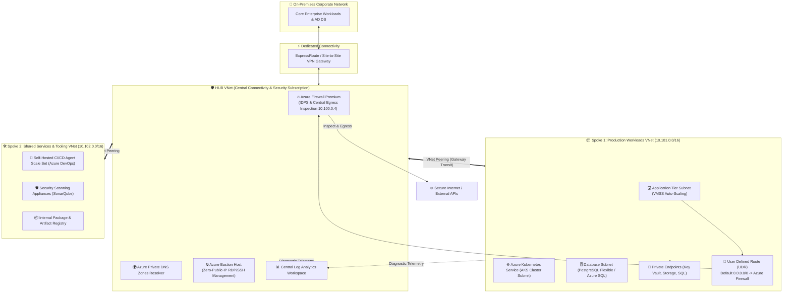
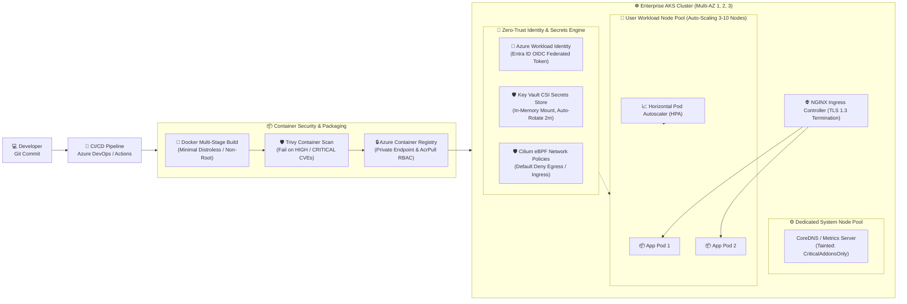
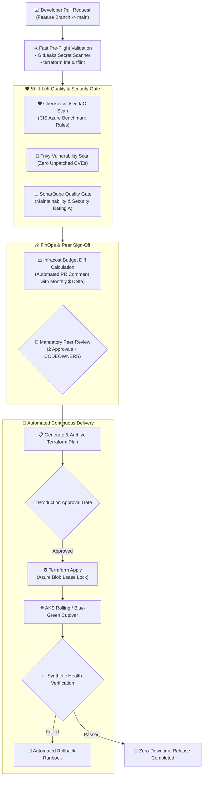

<div align="center">

<!-- Modern Cloud Native & Azure Profile Header Banner -->


# 👋 Hi there, I'm <mark style="background: linear-gradient(120deg, #0078D4 0%, #00C7B7 100%); color: white; padding: 4px 18px; border-radius: 8px; font-weight: 800; display: inline-block;">Neetu Patel</mark>

### 🚀 **Senior DevOps Engineer | Azure Cloud Architect | Terraform IaC | Kubernetes (AKS) | DevSecOps | CI/CD Automation**

[+with+Cilium+eBPF+%26+Docker;Zero-Trust+Security+with+Azure+Workload+Identity;Enterprise+CI%2FCD+with+Azure+DevOps+%26+GitHub+Actions;Nightly+Automated+IaC+Drift+Detection+%26+Remediation;Shift-Left+DevSecOps+(Checkov%2C+Trivy%2C+GitLeaks);FinOps+Leader+%7C+Continuous+Cloud+Cost+Optimization)](https://git.io/typing-svg)

<p align="center">
  <a href="https://linkedin.com/in/patelneetu10"></a>
  <a href="mailto:patel.neetu10@gmail.com"></a>
  <a href="https://github.com/patelneetu10-stack"></a>
  <a href="https://github.com/CloudEngineeringHub"></a>
  <a href="#"></a>
  <a href="#"></a>
</p>

<!-- Quick Navigation Bar -->
<p align="center">
  <a href="#-executive-summary--engineering-philosophy"><b>About Me</b></a> •
  <a href="#-quantified-production-engineering-impact"><b>Impact Metrics</b></a> •
  <a href="#-enterprise-technical-arsenal"><b>Tech Stack</b></a> •
  <a href="#-production-architectural-blueprints"><b>Architecture Blueprints</b></a> •
  <a href="#-real-world-engineering-scenarios--problem-solving"><b>Real-World Scenarios</b></a> •
  <a href="#-production-resilience-sre--disaster-recovery"><b>SRE & DR</b></a> •
  <a href="#-featured-production-repositories"><b>Featured Repositories</b></a> •
  <a href="#-lets-connect--collaborate"><b>Contact</b></a>
</p>

---

### 🌐 *"Designing Deterministic Infrastructure, Resilient Cloud Platforms, Zero-Trust Security & Frictionless CI/CD Delivery"*

<br/>

<!-- Production Cloud Platform & DevSecOps Architecture Blueprint -->
<p align="center">
  
</p>

</div>

<br/>

## 👨‍💼 Executive Summary & Engineering Philosophy

With **5+ years of hands-on production experience**, I specialize in designing, building, and operating enterprise-scale cloud foundations on **Microsoft Azure**. My core focus is delivering **resilient, self-healing, and audit-ready infrastructure** orchestrated through **modular Terraform**, containerized with **Docker**, orchestrated on **Azure Kubernetes Service (AKS)**, and automated via **Azure DevOps and GitHub Actions CI/CD pipelines**.

I approach DevOps as a disciplined software engineering practice:
- **Infrastructure is Code:** Zero manual portal clicks. Everything is version-controlled, modularized with strict semantic versioning, and protected against state corruption and drift.
- **Security is Shift-Left:** Compliance, secrets governance, and vulnerability scanning are non-negotiable PR gates—not post-deployment audits.
- **Platforms Empower Teams:** Developers deploy software frictionlessly using automated, self-healing delivery pipelines with integrated blue-green rollouts and automated rollbacks.

```
                                [ The Modern Platform Mindset ]
                                               │
                         "Automate, Secure, Observe & Scale Deterministically"
                                               │
         ┌─────────────────────────────────────┼─────────────────────────────────────┐
         │                                     │                                     │
 [ Infrastructure as Code ]           [ Cloud & AKS Platform ]             [ CI/CD & DevSecOps ]
  • Reusable Terraform Modules         • Azure CAF Hub-and-Spoke            • Multi-Stage Declarative Pipelines
  • Blob Lease Remote State Locking    • System vs User Pool Isolation      • Shift-Left Gates (Checkov, Trivy)
  • Nightly Unattended Drift Audits    • Cilium eBPF Network Policies       • Automated Blue-Green Rollouts
  • Infracost CI Budget Guardrails     • Workload Identity (Zero Secrets)   • Branch Protection & CODEOWNERS
```

---

## 📈 Quantified Production Engineering Impact

<table align="center" width="100%">
  <tr>
    <td align="center" width="16%">
      <h3>☸️ 99.99% SLA</h3>
      <p><b>High Availability</b><br/>Multi-AZ AKS clusters, zone-redundant PostgreSQL & self-healing VMSS.</p>
    </td>
    <td align="center" width="16%">
      <h3>🛡️ Zero-Drift IaC</h3>
      <p><b>Configuration Audit</b><br/>Nightly CI drift detection pipelines catching out-of-band portal changes.</p>
    </td>
    <td align="center" width="16%">
      <h3>🔐 Zero-Trust Posture</h3>
      <p><b>Identity Governance</b><br/>Eliminated long-lived secrets using Entra ID Workload Identity & Key Vault CSI.</p>
    </td>
    <td align="center" width="16%">
      <h3>⚡ &lt; 15m RTO</h3>
      <p><b>Disaster Recovery</b><br/>Automated ASR failover runbooks with &lt; 5m transactional RPO replication.</p>
    </td>
    <td align="center" width="16%">
      <h3>🚀 10m Deploy Lead</h3>
      <p><b>Delivery Speed</b><br/>Reduced release cycle times from hours to minutes via optimized runner scale sets.</p>
    </td>
    <td align="center" width="16%">
      <h3>💰 35% FinOps Saved</h3>
      <p><b>Cost Optimization</b><br/>P95 compute rightsizing, off-hour auto-shutdowns & Infracost PR guardrails.</p>
    </td>
  </tr>
</table>

---

## 🛠️ Enterprise Technical Arsenal

<div align="center">

| Domain | Core Technologies & Production Competencies |
| :--- | :--- |
| **Cloud Platforms & Networking** |      `Cloud Adoption Framework (CAF)` `ExpressRoute` `UDR Forced Tunneling` `NAT Gateway` |
| **Infrastructure as Code (IaC)** |     `Modular Blueprints` `Azure Blob Remote State Locking` `Nightly Drift Detection` `Semantic Versioning` |
| **Containers & Orchestration** | -326CE5?style=flat-square&logo=kubernetes&logoColor=white)     `HPA / VPA` `Cilium eBPF` `Azure Workload Identity` `Key Vault CSI Driver` `Distroless Builds` |
| **CI/CD & GitOps Automation** |    `Multi-Stage YAML` `Self-Hosted Scale Set Runners` `Branch Policies` `Approval Gates` `Blue-Green Cutover` |
| **DevSecOps & Governance** |      `Microsoft Defender for Cloud` `PIM/JIT` `Entra ID RBAC` `Azure Policy` `CIS Benchmarks` |
| **Operating Systems & Scripting** |      `Cloud-Init` `Systemd Services` `Automated Runbooks` |
| **Observability & SRE** |  -0078D4?style=flat-square)    `Distributed Tracing` `Synthetic Health Checks` |
| **FinOps & Cloud Economics** |   `FinOps Principles` `P95 Sizing Analysis` `Reserved Instances` `Savings Plans` `Cost Center Tagging` |

</div>

---

## 🏛️ Production Architectural Blueprints

### 1. Enterprise Azure Hub-and-Spoke Landing Zone (CAF)
> **Codebase:** [`patelneetu10-stack/azure-landing-zone`](https://github.com/patelneetu10-stack/azure-landing-zone)

Centralized egress and ingress inspection, zero overlapping CIDR blocks, forced tunneling (`0.0.0.0/0`), and strict private link connectivity across enterprise subscriptions.



**Key Engineering Architectural Decisions:**
- **Zero-Trust Egress Routing:** All outbound internet traffic from workload spokes is forcibly redirected via UDRs to Azure Firewall Premium for SNAT, FQDN filtering, and TLS payload inspection.
- **Private PaaS Perimeters:** All PaaS dependencies (Azure Key Vault, Storage Accounts, databases) communicate strictly through Azure Private Endpoints with disabled public network access.
- **Micro-Segmentation:** Inter-subnet Network Security Groups (NSGs) implement strict least-privilege flow control with zero cross-environment contamination.

---

### 2. Hardened Production Kubernetes (AKS) & Container Ecosystem
> **Codebase:** [`patelneetu10-stack/aks-cluster-infra`](https://github.com/patelneetu10-stack/aks-cluster-infra)

Production-hardened Azure Kubernetes Service (AKS) platform orchestrated with Docker multi-stage builds, Azure CNI Overlay, Cilium eBPF network policies, and Microsoft Entra ID Workload Identity.



**Production Kubernetes Engineering Standards:**
- **Zero Static Service Principal Secrets:** Workload Identity binds Kubernetes service accounts to Azure User-Assigned Managed Identities via OIDC federation, eliminating password expiration and secret leak risks.
- **Dynamic Secret Rotation via Key Vault CSI:** Secrets and TLS certificates are mounted directly into memory as tmpfs volumes with an automated 2-minute rotation polling cycle.
- **Isolated Node Planes:** System node pool is tainted with `CriticalAddonsOnly`, isolating control plane utilities from user workload crash loops or memory exhaustion.
- **eBPF Kernel-Level Security:** Cilium eBPF replaces kube-proxy for line-rate packet routing, layer-7 egress filtering, and fine-grained network policy enforcement.

---

### 3. Enterprise DevSecOps CI/CD Deployment Flow
> **Codebase:** [`patelneetu10-stack/platform-infrastructure-prod`](https://github.com/patelneetu10-stack/platform-infrastructure-prod)

Deterministic, shift-left multi-stage deployment pipeline spanning pull request validation, automated security gates, Infracost budget impact, and continuous delivery.



---

### 4. Regulatory-Compliant Healthcare Cloud Infrastructure (HIPAA / HITRUST)
> **Codebase:** [`patelneetu10-stack/healthcare-platform-infra`](https://github.com/patelneetu10-stack/healthcare-platform-infra)

Hardened, audit-ready healthcare cloud foundation engineered for Protected Health Information (PHI) workloads with customer-managed cryptographic keys and immutable audit storage.

```mermaid
flowchart TD
    subgraph IdentityCompliance ["🛡️ Governance & Cryptographic Control Boundary"]
        RBAC["Entra ID RBAC (PIM / JIT Access)"]
        HSM["🔐 Azure Key Vault HSM (CMK Encryption & Purge Protection)"]
        AuditLaw["📋 HIPAA Audit Logs (730-Day Retention WORM)"]
    end

    subgraph HealthcareVNet ["🏥 Healthcare Isolated VNet (10.210.0.0/16)"]
        subgraph AppSubnet ["💻 App Service Tier (10.210.1.0/24)"]
            App["Microservices / FHIR API\n(VNet Integrated, Zero Public IP)"]
        end

        subgraph DbSubnet ["🗄️ Delegated Database Subnet (10.210.2.0/24)"]
            PSQLPrimary["🐘 Azure PostgreSQL Flexible Server\nPrimary Zone 1 (CMK Encryption)"]
            PSQLStandby["🐘 Zone-Redundant Standby Server\nStandby Zone 2 (Automatic Failover RTO < 60s)"]
        end

        subgraph PrivateLinkSubnet ["🔗 Private Endpoint Subnet (10.210.3.0/24)"]
            StoragePrivateLink["Storage Private Link Endpoint"]
        end
    end

    subgraph StorageTier ["📦 Medical Records & PHI Storage"]
        ImmutableStorage["Immutable Blob Storage (GRS)\n(WORM Policy & Versioning)"]
    end

    App -->|TLS 1.3 / Private VNet| PSQLPrimary
    PSQLPrimary <==>|Synchronous Replication| PSQLStandby
    App --> StoragePrivateLink --> ImmutableStorage
    HSM -->|Customer Managed Key (CMK)| PSQLPrimary
    HSM -->|Customer Managed Key (CMK)| ImmutableStorage
    HealthcareVNet -.->|Diagnostic Logs Streamed| AuditLaw
```

---

## 💡 Real-World Engineering Scenarios & Problem-Solving

Real cloud environments face unexpected challenges. Here is how I solve critical production infrastructure challenges:

### 🧩 Scenario 1: Eliminating Out-of-Band Cloud Drift in Multi-Developer Environments
- **The Problem:** Developers or support teams occasionally make emergency out-of-band changes directly in the Azure Portal (e.g., tweaking an NSG rule or changing a VM SKU). When the next Terraform pipeline runs, it either overwrites the fix or fails due to unexpected state discrepancy.
- **The Solution Implemented:**
  1. Built an automated **Nightly Drift Detection Workflow** in GitHub Actions running `terraform plan -detailed-exitcode` across all production state files.
  2. If drift is detected (exit code 2), an automated incident is dispatched with the exact execution plan diff to Microsoft Teams / Slack, alerting engineers before production is impacted.
  3. Enforced strict Azure Policy assignments with `Deny` effects preventing unauthorized manual resource creation outside version-controlled deployment service principals.

### 🔑 Scenario 2: Eliminating Plaintext Credentials with Azure Workload Identity & Key Vault CSI
- **The Problem:** Microservices deployed on Kubernetes traditionally required long-lived Service Principal client secrets stored as Kubernetes secrets (base64 encoded), creating credential rotation overhead and leakage risks.
- **The Solution Implemented:**
  1. Enabled **Azure Workload Identity** with OIDC federation on the AKS cluster.
  2. Mapped Kubernetes Service Accounts to Azure User-Assigned Managed Identities with least-privilege RBAC roles.
  3. Deployed the **Azure Key Vault Secrets Store CSI Driver** to mount secrets, database connection strings, and certificates directly into pods as in-memory filesystem volumes with automated 2-minute rotation.
  4. Result: Zero plaintext secrets stored in git or Kubernetes etcd, zero manual rotation downtime.

### 🛡️ Scenario 3: Enforcing Strict Egress Perimeter & Data Exfiltration Prevention
- **The Problem:** Default Azure virtual network subnets allow unrestricted direct outbound connectivity to the internet, creating risks of unauthorized data egress or malware command-and-control communication.
- **The Solution Implemented:**
  1. Designed and deployed an **Enterprise Hub-and-Spoke topology** governed by User-Defined Routes (UDRs) with `0.0.0.0/0` pointing directly to the private IP of **Azure Firewall Premium**.
  2. Implemented TLS inspection, IDPS (Intrusion Detection and Prevention System), and structured Application Rule Collections restricting egress to explicitly approved domain FQDNs.
  3. Converted all cloud PaaS service access (Azure Key Vault, Storage Accounts, databases) to communicate solely via **Azure Private Endpoints**, completely removing public internet exposure.

### 💰 Scenario 4: Shift-Left DevSecOps & FinOps in Continuous Integration
- **The Problem:** Architectural anti-patterns (such as unencrypted disks, publicly accessible storage, or over-provisioned expensive VM instances) were often discovered only after infrastructure was already provisioned and billed.
- **The Solution Implemented:**
  1. Integrated **Checkov & tfsec** into PR validation workflows to enforce CIS Azure Foundations Benchmark rules before code merges.
  2. Added **Infracost** directly to pull requests, posting automated markdown tables showing the exact monthly financial delta (`+$34.20/month`) and flagging budget threshold breaches.
  3. Configured branch protection rules requiring passing security and cost checks alongside 2 senior engineer peer approvals.

---

## 🛡️ Production Resilience, SRE & Disaster Recovery

```
                            [ Resilient Cloud SLA Framework ]
                                           │
         ┌─────────────────────────────────┼─────────────────────────────────┐
         │                                 │                                 │
 [ High Availability ]            [ Disaster Recovery ]            [ Observability & Telemetry ]
  • Multi-AZ Nodepools (1, 2, 3)   • RTO < 15 Min (ASR Runbooks)    • Log Analytics KQL Queries
  • Zone-Redundant PaaS Instances  • RPO < 5 Min (Geo-Replication)  • Azure Monitor Dynamic Alerts
  • Self-Healing VMSS Probes       • Immutable GRS Storage Vaults   • Distributed APM Tracing
```

- **Storage Durability:** Zone-Redundant Storage (ZRS) across three physical availability zones for operational data; Geo-Redundant Storage (GRS) for critical backups and long-term compliance archives.
- **Disaster Recovery Targets:**
  - **RTO (Recovery Time Objective):** `< 15 minutes` via scripted failover automation and infrastructure recovery runbooks.
  - **RPO (Recovery Point Objective):** `< 5 minutes` through continuous transactional database replication.
- **Incident Response & SRE:** Custom KQL alerting rules deployed across centralized Log Analytics Workspaces with automated escalation to PagerDuty and on-call engineering teams.

---

## 🌟 Featured Production Repositories

Explore my end-to-end, production-grade infrastructure codebases:

<table width="100%">
  <tr>
    <td width="50%" valign="top">
      <h3>🏛️ <a href="https://github.com/patelneetu10-stack/azure-landing-zone">azure-landing-zone</a></h3>
      <p>Enterprise Azure Cloud Adoption Framework (CAF) Hub-and-Spoke Landing Zone orchestrated with Terraform. Includes Azure Firewall Premium, Azure Bastion, UDR forced tunneling, and CIS v2.0 benchmark compliance.</p>
      <p>
        
        
        
      </p>
      <pre><code>git clone https://github.com/patelneetu10-stack/azure-landing-zone.git</code></pre>
    </td>
    <td width="50%" valign="top">
      <h3>☸️ <a href="https://github.com/patelneetu10-stack/aks-cluster-infra">aks-cluster-infra</a></h3>
      <p>Hardened Azure Kubernetes Service (AKS) platform with Cilium eBPF network policies, Entra ID Workload Identity, automated Key Vault CSI secret rotation, and Azure Container Registry (ACR) integration.</p>
      <p>
        
        
        
      </p>
      <pre><code>git clone https://github.com/patelneetu10-stack/aks-cluster-infra.git</code></pre>
    </td>
  </tr>
  <tr>
    <td width="50%" valign="top">
      <h3>⚙️ <a href="https://github.com/patelneetu10-stack/platform-infrastructure-prod">platform-infrastructure-prod</a></h3>
      <p>Enterprise production platform baseline featuring Azure NAT Gateway with deterministic static egress, Redis distributed caching, Application Insights APM, and automated nightly drift detection workflows.</p>
      <p>
        
        
        
      </p>
      <pre><code>git clone https://github.com/patelneetu10-stack/platform-infrastructure-prod.git</code></pre>
    </td>
    <td width="50%" valign="top">
      <h3>🏥 <a href="https://github.com/patelneetu10-stack/healthcare-platform-infra">healthcare-platform-infra</a></h3>
      <p>HIPAA & HITRUST-compliant healthcare infrastructure on Azure with zone-redundant PostgreSQL Flexible Server (CMK encryption), HSM Key Vault, and 730-day WORM immutable storage.</p>
      <p>
        
        
        
      </p>
      <pre><code>git clone https://github.com/patelneetu10-stack/healthcare-platform-infra.git</code></pre>
    </td>
  </tr>
</table>

---

## 📊 Live GitHub Analytics & Activity

<div align="center">


<br/><br/>


</div>

---

## 🤝 Let's Connect & Collaborate

I am actively open to discussing **Senior DevOps Engineer**, **Azure Cloud Platform Engineer**, and **Cloud Infrastructure Architect** roles.

Whether you're looking to architect modular Terraform landing zones, containerize applications with Docker & Kubernetes (AKS), establish zero-trust DevSecOps pipelines, or build highly available cloud platforms:

<div align="center">

<p align="center">
  <a href="https://linkedin.com/in/patelneetu10"></a>
  &nbsp;&nbsp;
  <a href="mailto:patel.neetu10@gmail.com"></a>
  &nbsp;&nbsp;
  <a href="https://github.com/patelneetu10-stack"></a>
</p>

```
"Infrastructure is code. Security is continuous. Automation is paramount. Resilience is non-negotiable."
```

⭐ **If you find these architectural patterns and Terraform modules valuable, feel free to explore the repositories and leave a star!**

<br/>

<!-- Modern Sleek Waving Footer -->


</div>
