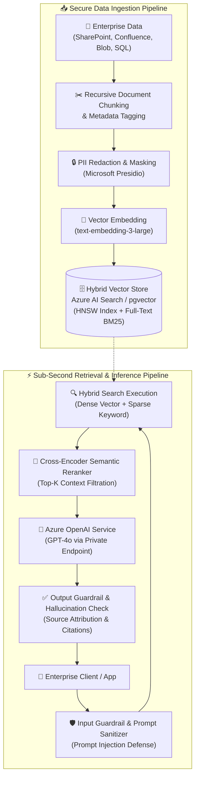
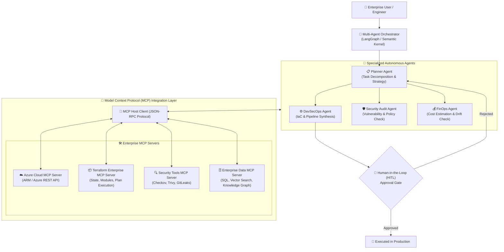
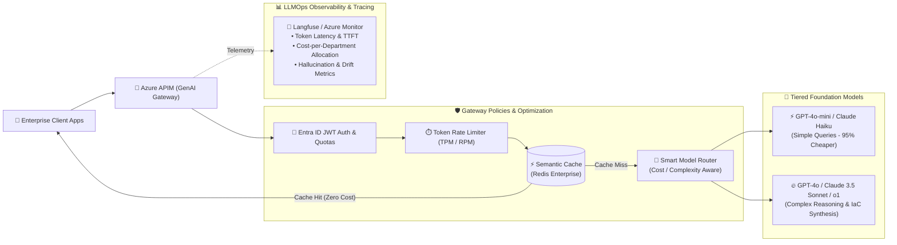
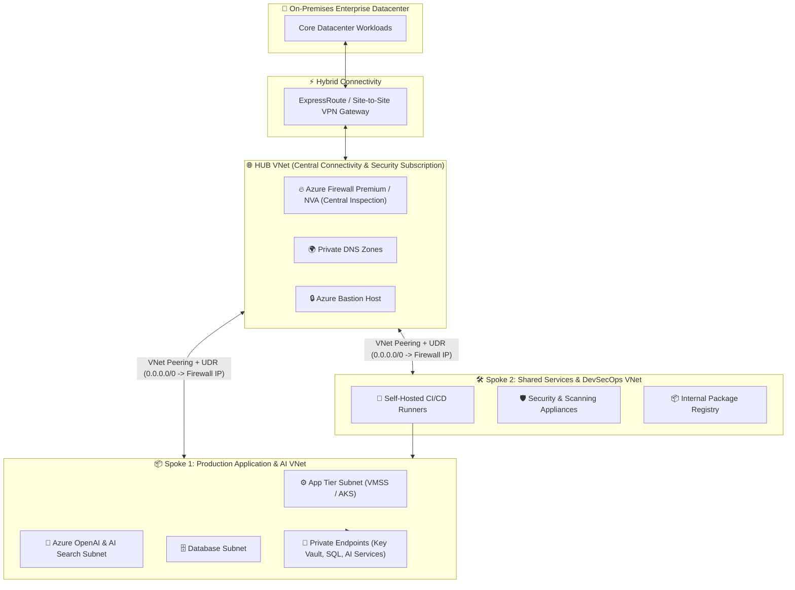
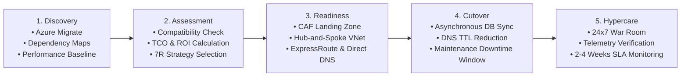
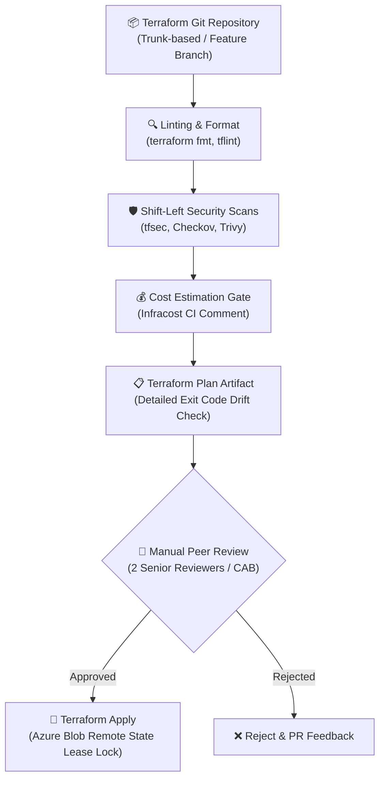

<div align="center">

<!-- Animated Header Wave Banner with Glowing Highlighted Name -->


<!-- Animated Glowing Cyber Laser Divider -->


<br/>

# 👋 Hi there, I'm <mark style="background: linear-gradient(120deg, #0078D4 0%, #00C7B7 100%); color: white; padding: 4px 18px; border-radius: 8px; font-weight: 800; display: inline-block;">Neetu Patel</mark> 

### 🚀 **Building Secure, Scalable & Automated Cloud Infrastructure with Azure, Terraform, Kubernetes and CI/CD.**

[;Production+RAG+Pipelines+%26+Hybrid+Vector+Search;Migrated+100%2B+Enterprise+Workloads+with+Zero+Downtime;FinOps+Leader+%7C+%241.2M%2B+Cloud+%26+Token+OpEx+Saved+(28%25);Zero-Trust+Security+%7C+100%25+CIS+Benchmark+Compliance)](https://git.io/typing-svg)

<p align="center">
  <a href="https://linkedin.com/in/"></a>
  <a href="mailto:patel.neetu10@gmail.com"></a>
  <a href="#"></a>
  <a href="#"></a>
</p>

<!-- Quick Navigation Bar -->
<p align="center">
  <a href="#-executive-summary--philosophy-"><b>Executive Summary</b></a> •
  <a href="#-core-architecture-pillars"><b>Core Pillars</b></a> •
  <a href="#-quantified-enterprise-business-impact"><b>Impact Metrics</b></a> •
  <a href="#-industry-certifications--credentials"><b>Certifications</b></a> •
  <a href="#-enterprise-technical-arsenal"><b>Tech Stack</b></a> •
  <a href="#1-enterprise-production-rag-retrieval-augmented-generation-architecture"><b>Production RAG</b></a> •
  <a href="#2-autonomous-agentic-ai--model-context-protocol-mcp-ecosystem"><b>Agentic AI & MCP</b></a> •
  <a href="#3-llmops-ai-gateway--genai-finops-architecture"><b>LLMOps</b></a> •
  <a href="#5-enterprise-hub-and-spoke-networking-architecture"><b>Hub & Spoke</b></a> •
  <a href="#8-production-grade-terraform-landing-zone--automation-pipeline"><b>Terraform IaC</b></a> •
  <a href="#11-finops-cloud-financial-management--economics-framework"><b>FinOps</b></a> •
  <a href="#-live-github-analytics--activity"><b>GitHub Stats</b></a>
</p>

---

### 🌐 *"Bridging Business ROI, Zero-Trust DevSecOps, Enterprise Cloud Architecture & Autonomous Agentic AI"*

</div>

<br/>

## 📌 Core Architecture Pillars & Mission

> *"Building Secure, Scalable & Automated Cloud Infrastructure with Azure, Terraform, Kubernetes and CI/CD."*

- 🔒 **Secure by Design:** End-to-end Zero-Trust posture with Microsoft Entra ID Privileged Identity Management (PIM/JIT), automated CIS Azure Benchmarks, Checkov/Trivy shift-left static analysis, secret scanning (GitLeaks), and OWASP Top 10 for LLMs guardrails.
- 📈 **Scalable & Resilient:** Enterprise Hub-and-Spoke Landing Zones, multi-Availability Zone compute (VMSS & AKS node auto-scaling), and geo-redundant storage delivering **99.99% availability** with RTO < 15m and RPO < 5m.
- ⚙️ **Automated Infrastructure (IaC):** 100% declarative infrastructure orchestrated through modular, version-controlled Terraform with remote state lease locking in Azure Blob and scheduled unattended nightly drift detection pipelines.
- ☁️ **Azure Enterprise Foundation:** Microsoft Cloud Adoption Framework (CAF) management group hierarchy, private link endpoints for all PaaS services, and centralized traffic inspection through Azure Firewall Premium.
- ☸️ **Kubernetes (AKS) & Cloud Native:** Microservices orchestration with AKS, Helm charts, automated container image scanning, Istio service mesh, and GitOps delivery models.
- 🔄 **Enterprise CI/CD Pipelines:** Trunk-based branching strategies, mandatory multi-reviewer pull request policies, automated quality gates, and automated deployment rollback runbooks across Azure DevOps and GitHub Actions.


<br/>

## 🏆 Industry Certifications & Credentials

<div align="center">

[-0078D4?style=for-the-badge&logo=microsoft-azure&logoColor=white)](#)
[-0078D4?style=for-the-badge&logo=microsoft-azure&logoColor=white)](#)
[-0078D4?style=for-the-badge&logo=microsoft-azure&logoColor=white)](#)

[-844FBA?style=for-the-badge&logo=terraform&logoColor=white)](#)
[-326CE5?style=for-the-badge&logo=kubernetes&logoColor=white)](#)
[-107C41?style=for-the-badge&logo=linux-foundation&logoColor=white)](#)

</div>

---

## 👨‍💼 Executive Summary & Philosophy 

With **5+ years of battle-tested enterprise experience**, I operate at the nexus of **business strategy, enterprise cloud architecture, DevSecOps, and production Generative AI / Agentic systems**. 

In senior, lead, and architect-level engagements, technical excellence is not measured solely by tool syntax—it is defined by **delivering verifiable business ROI, eliminating existential security risks, enforcing governance, and architecting scalable, resilient platforms**. 

From leading the migration of **100+ mission-critical workloads to Azure with zero downtime**, to engineering **autonomous Multi-Agent systems powered by the Model Context Protocol (MCP)** and **enterprise-grade RAG pipelines with sub-second vector retrieval**, I design production ecosystems that bridge bleeding-edge AI innovation with bank-grade security and FinOps discipline.

```
                              [ The Senior Mindset ]
                                         │
                    "What is the Business & Functional Domain?"
                                         │
     ┌───────────────────────────────────┼───────────────────────────────────┐
     │                                   │                                   │
[ Cloud & DevSecOps Platform ]   [ Enterprise GenAI & Agentic AI ]   [ Application System Design ]
 • Azure CAF Landing Zones        • Model Context Protocol (MCP)      • Microservices vs Monolith
 • Hub-and-Spoke Networking       • Enterprise RAG & Hybrid Vectors   • API Gateways & Service Mesh
 • Terraform Drift Automation     • Multi-Agent Orchestration         • Event-Driven & CQRS Patterns
 • Zero-Trust & FinOps Governance • LLMOps & Guardrails (OWASP LLM)   • Distributed Caching & State
```

---

## 📈 Quantified Enterprise Business Impact

<table align="center" width="100%">
  <tr>
    <td align="center" width="16%">
      <h3>🚀 100+ Workloads</h3>
      <p><b>Cloud Migration</b><br/>Zero-downtime cutover from On-Premises datacenters to Azure Landing Zones.</p>
    </td>
    <td align="center" width="16%">
      <h3>🤖 Agentic AI & RAG</h3>
      <p><b>Enterprise GenAI</b><br/>Production RAG & MCP multi-agent systems with sub-400ms retrieval and strict RBAC.</p>
    </td>
    <td align="center" width="16%">
      <h3>💰 28% OpEx Saved</h3>
      <p><b>FinOps & LLM Cost</b><br/><b>$1.2M+</b> annual reduction via rightsizing, RI/Savings Plans & semantic caching.</p>
    </td>
    <td align="center" width="16%">
      <h3>🛡️ 100% Guardrails</h3>
      <p><b>Zero-Trust & OWASP</b><br/>Automated CIS Azure Benchmarks, PIM/JIT, prompt injection defense & PII masking.</p>
    </td>
    <td align="center" width="16%">
      <h3>⚡ 99.99% Availability</h3>
      <p><b>Resilience & SRE</b><br/>Multi-AZ VMSS, ZRS/GRS redundancy, and automated ASR disaster recovery (RTO &lt; 15m).</p>
    </td>
    <td align="center" width="16%">
      <h3>🔄 90% Faster Release</h3>
      <p><b>Trunk CI/CD Pipelines</b><br/>Automated validation, secret scanning, drift detection, and rollback gates.</p>
    </td>
  </tr>
</table>

---

## 🛠️ Enterprise Technical Arsenal

<div align="center">

| Domain | Core Technologies & Enterprise Competencies |
| :--- | :--- |
| **Agentic AI & Orchestration** | -000000?style=flat-square&logo=anthropic&logoColor=white)     `Multi-Agent Workflows` `Function Calling` `Human-in-the-Loop` |
| **Enterprise RAG & Vector Stores** |     `Hybrid Search (Dense + BM25)` `Cross-Encoder Reranking` `HNSW Indexing` `Chunking Strategies` |
| **LLMs, Inference & LLMOps** | -0078D4?style=flat-square&logo=openai&logoColor=white)     `Semantic Caching (Redis)` `Token Rate Limiting` `Smart Model Routing` |
| **GenAI Security & AI Guardrails** |    -0078D4?style=flat-square) `Prompt Injection Defense` `Data Poisoning Prevention` `Output Hallucination Validation` |
| **Cloud Platforms & Architecture** |   `Cloud Adoption Framework (CAF)` `Enterprise Landing Zones` `Hub-and-Spoke` `Virtual WAN` |
| **Infrastructure as Code (IaC)** |     `State Locking` `Nightly Drift Detection` |
| **DevSecOps & Security Tools** |      `Microsoft Defender for Cloud` `PIM` |
| **Containers & Orchestration** | -326CE5?style=flat-square&logo=kubernetes&logoColor=white)    `Istio Service Mesh` `Network Policies` |
| **CI/CD & GitOps Automation** |    `Multi-Stage YAML` `Branch Policies` `Approvals Gate` |
| **FinOps & Cloud Governance** |   `FinOps Foundation Principles` `Reserved Instances` `Savings Plans` `Cost Allocation Tags` |
| **Observability, SRE & Logging** |      |
| **Scripting & System Admin** |     |

</div>

---

## 🏛️ Enterprise Architecture Blueprints & Deep-Dive Playbooks

### 1. Enterprise Production RAG (Retrieval-Augmented Generation) Architecture

End-to-end production RAG blueprint featuring **hybrid search (Dense Vectors + BM25 Sparse Keyword)**, cross-encoder semantic reranking, PII redaction, and sub-second retrieval with private link isolation.



> **Enterprise RAG Engineering Highlights:**
> - **Hybrid Search with Semantic Reranking:** Combining dense embeddings for conceptual matching with sparse BM25 for domain-specific acronyms and part numbers, boosted by a semantic reranker for high precision.
> - **Zero-Data Exfiltration:** Models deployed inside Azure virtual networks using Private Endpoints; enterprise customer data is never used for foundation model training.
> - **Metadata-Driven Document Level Security (DLS):** Embedding Entra ID Security Group ACLs into vector metadata to ensure users only retrieve documents they are authorized to view.

---

### 2. Autonomous Agentic AI & Model Context Protocol (MCP) Ecosystem

Multi-agent collaborative framework leveraging the **Model Context Protocol (MCP)** to securely bridge autonomous AI agents with enterprise tools, databases, infrastructure APIs, and Human-in-the-Loop governance.



> **Model Context Protocol (MCP) Capabilities:**
> - **Standardized Tool Integration:** Universal JSON-RPC protocol allowing foundation models to interact dynamically with enterprise databases, Terraform states, and Azure resources without brittle custom wrappers.
> - **Least-Privilege Tool Scoping:** Each MCP server enforces strict RBAC and schema validation; agents never hold root credentials.
> - **Human-in-the-Loop (HITL) Safety:** Critical actions (destructive Terraform applies, firewall modifications, IAM role assignments) pause for mandatory senior peer sign-off.

---

### 3. LLMOps, AI Gateway & GenAI FinOps Architecture

Enterprise-grade AI gateway architecture managing API throughput, token costs, rate limits, and continuous observability.



> **GenAI FinOps Engineering:**
> - **Semantic Caching:** High-speed vector caching of frequent semantic questions, eliminating redundant inference calls and **reducing LLM token expenditure by up to 40%**.
> - **Intelligent Model Routing:** Dynamically evaluating prompt complexity to route classification and parsing tasks to low-cost models, reserving frontier reasoning models for complex architecture design.
> - **Departmental Chargeback:** Precise token attribution via APIM subscription keys mapped to corporate cost centers.

---

### 4. OWASP Top 10 for LLMs & AI Defense-in-Depth Matrix

| OWASP Risk | Enterprise Attack Vector | Hardening Controls & Architecture Implemented |
| :--- | :--- | :--- |
| **LLM01: Prompt Injection** | Adversarial jailbreaking & indirect injection via external data sources. | Dual-stage input sanitization, separate system/user context demarcation, Azure AI Content Safety filters, and NeMo Guardrails. |
| **LLM02: Sensitive Data Disclosure** | Accidental leakage of PII/PHI or proprietary source code in responses. | Microsoft Presidio automated pre-ingestion redaction, DLP filters, and synthetic data substitution during model fine-tuning. |
| **LLM06: Excessive Agency** | Autonomous agents executing unintended destructive infrastructure actions. | Model Context Protocol (MCP) granular tool permissions, read-only default postures, and mandatory Human-in-the-Loop approvals. |
| **LLM08: Vector & Embedding Poisoning** | Malicious injection into vector databases to bias enterprise RAG results. | Cryptographic hash verification of source documents, strict ingestion pipeline access control, and anomaly detection on embeddings. |
| **LLM10: Model Denial of Service** | Resource exhaustion via unbounded recursive queries or massive context dumps. | APIM Token Rate Limiting (TPM/RPM), hard token caps per request, and streaming timeout constraints. |

---

### 5. Enterprise Hub-and-Spoke Networking Architecture

Centralized egress/ingress inspection, zero overlapping CIDR blocks, forced tunneling (`0.0.0.0/0`), and strict private link connectivity for enterprise workloads.



> **Key Networking Engineering Highlights:**
> - **IP Address Management (IPAM):** Non-overlapping RFC 1918 CIDR allocation across on-premises data centers and cloud landing zones.
> - **Zero-Trust Egress/Ingress:** All outbound internet traffic routed via User Defined Routes (`0.0.0.0/0`) through Azure Firewall with SNAT, FQDN filtering, and TLS inspection.
> - **Private PaaS & AI:** PaaS and GenAI services (Azure OpenAI, Azure AI Search, Key Vault, Storage Accounts) communicate exclusively over Private Endpoints without public IPs.

---

### 6. Enterprise Governance, Identity & Management Hierarchy (Microsoft CAF)

Adhering strictly to the **Microsoft Cloud Adoption Framework (CAF)** across its six iterative phases: `Strategy` ➔ `Plan` ➔ `Ready` ➔ `Adopt` ➔ `Govern` ➔ `Secure & Manage`.

```
                            [ Microsoft Entra ID Tenant ]
                                          │
                              [ Tenant Root Group ]
                                          │
         ┌────────────────────────────────┼────────────────────────────────┐
         │                                │                                │
[ Platform Management Group ]   [ Landing Zones (Workloads) ]    [ Decommissioned / Sandbox ]
   ├── Identity (AD/DNS)           ├── Corp (Internal Only)         ├── Sandbox MG
   ├── Management (Logs/Mon)       ├── Online (Public/DMZ)          └── Decommissioned MG
   └── Connectivity (Hub/Firewall) ├── Dev Subscriptions
                                   ├── UAT Subscriptions
                                   └── Prod Subscriptions
```

> **Governance & Identity Hardening:**
> - **Subscription Boundaries:** Environment separation (Dev, UAT, Prod) and functional isolation (Platform vs. Workload) to eliminate blast radius and noisy-neighbor effects.
> - **Azure Policy & Initiatives:** Auditing and denial enforcement via CIS Microsoft Azure Foundations Benchmark and Microsoft Cloud Security Benchmark (MCSB) applied at the Management Group root.
> - **Entra ID Privileged Identity Management (PIM):** Zero permanent elevated privileges (`Global Admin`, `Owner`, `Contributor`). Access is granted Just-In-Time (JIT) with mandatory MFA, ticketing business justification, and multi-stage manager approvals.

---

### 7. Real-World Architecture: 100+ Enterprise Workload Migration

A production-proven framework for modernizing and migrating 100+ mission-critical workloads from on-premises VMware/Hyper-V environments to Azure.



#### 🛡️ The 10 Scalability & Quality Architecture Pillars
1. **Scalable:** Auto-scaling VMSS, AKS node pools, and database elastic pools.
2. **Robust:** Decoupled asynchronous event queues (Azure Service Bus) absorbing traffic spikes.
3. **Secure:** Zero-Trust identity, micro-segmented NSGs/ASGs, and encrypted data at rest/in transit.
4. **Reliable:** Circuit breakers, health probes, automated self-healing, and zone redundancy.
5. **Portable:** Containerized standard microservices with declarative IaC.
6. **Governed:** Automated policy guardrails preventing non-compliant resource provisioning.
7. **High Availability:** Active-active multi-region/multi-zone architectures delivering 99.99% SLA.
8. **Cost-Optimized:** Continuous FinOps rightsizing, automated off-hour shutdowns, and Reservations.
9. **Backed Up:** Immutable, air-gapped Azure Recovery Services vaults with soft-delete enabled.
10. **Compliant & Monitored:** Centralized Log Analytics, AMA agent telemetry, and automated audit trails.

---

### 8. Production-Grade Terraform Landing Zone & Automation Pipeline

Standardized, modular, and drift-resistant Infrastructure as Code delivery.



> **IaC Enterprise Standards:**
> - **Remote State Security:** Stored in isolated, encrypted Azure Storage Accounts with Blob Lease Locking and Managed Identity auth (zero plaintext credentials).
> - **Strict Modularity:** Parameterized modules published to private registries with semantic versioning (`v1.2.0`).
> - **Nightly Drift Detection Pipelines:** Scheduled unattended pipelines running `terraform plan -detailed-exitcode` to immediately detect out-of-band portal alterations and trigger alerts.

---

### 9. Multi-Layered Defense-in-Depth Security Matrix

| Layer | Key Technologies | Hardening Controls & Architecture |
| :--- | :--- | :--- |
| **1. Identity** | Microsoft Entra ID, PIM, Conditional Access | Mandatory phishing-resistant MFA, Just-In-Time role activation, User Assigned Managed Identities, zero long-lived credentials. |
| **2. Network** | Azure Firewall Premium, NSGs, ASGs | Micro-segmentation, TLS inspection, IDPS (Intrusion Detection/Prevention), Private Endpoints, DDoS Protection Standard. |
| **3. Governance** | Azure Policy, CIS Benchmark, MCSB | Continuous compliance scanning, automated remediation/deny policies, Defender for Cloud Secure Score tracking (>85%). |
| **4. Compute & Host** | Defender for Servers, Qualys, Disk Encryption | Automated vulnerability scanning, OS baseline patch enforcement, Disk Encryption Sets with Customer-Managed Keys (CMK) in HSM Key Vault. |
| **5. CI/CD & AI Pipeline** | GitLeaks, Trivy, Checkov, SonarQube, Presidio | Pre-commit hooks, automated container base-image CVE scanning, pipeline secret scanning, mandatory PR reviews, prompt injection test suites. |

---

### 10. DevSecOps CI/CD Pipelines & Branch Governance

- **Branching Strategy:** Trunk-based development with short-lived feature branches (`feature/*`, `fix/*`).
- **Branch Protection Policies:**
  - Mandatory Pull Request (PR) with minimum **2 senior engineering approvals**.
  - Strict `CODEOWNERS` validation for architectural modifications.
  - Required passing status checks: Unit tests, Linting, Secret scan, and IaC validation.
  - "No Direct Push" and "No Branch Deletion" enforced on `main` and production branches.
- **Custom Middleware & Agent Setup:** Automated provisioning of baseline configurations via VM Custom Data and `Cloud-Init` scripts during scale-out.

---

### 11. FinOps (Cloud Financial Management & Economics) Framework

```
                          [ FinOps Enterprise Engine ]
                                       │
     ┌──────────────────┬──────────────┴─────┬──────────────────┐
     ▼                  ▼                    ▼                  ▼
[ Eliminate Waste ] [ Rightsizing ] [ Commitments ]    [ Telemetry Tuning ]
 • Unattached Disks  • 30-Day P95    • 1/3-Yr RIs       • DCR Log Filters
 • Orphaned IPs      • CPU/Mem Curve • Savings Plans    • Basic vs Analytics
 • Stale Snapshots   • Auto-Scaling  • Spot Instances   • Ingestion Caps
```

- **Waste Elimination:** Automated cron jobs identifying and purging unattached managed disks, orphaned snapshots, and unused public IPs.
- **Rightsizing:** Resizing underutilized VMs and databases based on 30-day 95th percentile CPU/RAM metrics.
- **Commitment Optimization:** Utilizing Azure Reservations and Savings Plans for steady-state workloads (up to 72% cost savings).
- **Automated Scheduling:** Automated start/stop runbooks for non-production environments outside business operating hours (saving ~65% non-prod compute).
- **Log Ingestion Tuning:** Configuring Data Collection Rules (DCR) in Azure Monitor Agent to drop noisy, non-critical telemetry before billing ingestion.

---

### 12. Backup, Disaster Recovery & High Availability (SRE)

- **Storage Redundancy:**
  - **LRS (Locally Redundant Storage):** 3 synchronous copies within a single datacenter for transient workloads.
  - **ZRS (Zone-Redundant Storage):** Synchronous replication across 3 physical availability zones in a region for mission-critical apps.
  - **GRS (Geo-Redundant Storage):** Asynchronous replication to a secondary paired region for disaster recovery resilience.
- **High Availability Compute:** Virtual Machine Scale Sets (VMSS) orchestrated across multiple Availability Zones with automated health probes.
- **Business Continuity Metrics:**
  - **RTO (Recovery Time Objective):** `< 15 Minutes` using automated Azure Site Recovery (ASR) orchestration runbooks.
  - **RPO (Recovery Point Objective):** `< 5 Minutes` through continuous transactional log shipping and geo-replication.

---

### 13. Enterprise Observability & SRE Incident Management

- **Centralized Telemetry:** Enterprise-wide Log Analytics Workspaces partitioned by environment and regulatory domain.
- **Azure Monitor Agent (AMA):** Source-level log filtering using custom KQL in Data Collection Rules (DCR).
- **Dynamic Alert Routing:** Action Groups integrated directly with Microsoft Teams, Slack, and PagerDuty with auto-escalation policies.

---

### 14. IT Career Tracks & Enterprise Delivery Governance

```
+------------+       +---------------+       +---------+       +----------------------+       +----------------+
|   Sales    | ----> |   Pre-Sales   | ----> |   TAM   | ----> | Enterprise Architect | ----> | Technical Lead |
| Commercial |       | Techno-       |       | Tech    |       | Infra + Application  |       | Infra / App    |
| Focus      |       | Functional    |       | Account |       | Strategy & Design    |       | Execution      |
|            |       | Proposals     |       | Manager |       |                      |       |                |
+------------+       +---------------+       +---------+       +----------------------+       +----------------+
```

Senior engineering requires mastery of the end-to-end delivery and procurement lifecycle:

```
[ RFI (Request for Information) ]
               │
[ RFP (Request for Proposal) ]
               │
[ Technical Evaluation Matrix (Architecture, Security, Cost) ]
               │
[ SOW (Statement of Work) & Commercial Terms ]
               │
[ Project Sprints & Deliverable Milestones ]
               │
[ Acceptance Criteria Sign-Off & Payment Release ]
```

- **SOW (Statement of Work):** Defining explicit technical deliverables, acceptance criteria, timeline milestones, RACI matrix, and liability boundaries.
- **Technical Evaluation Matrix:** Objectively benchmarking vendor architectures against security compliance, operational SLA, scalability, and TCO.
- **RACI Governance:** Clear alignment across **R**esponsible (executors), **A**ccountable (lead owner), **C**onsulted (SMEs), and **I**nformed (stakeholders).
- **Executive Leadership:** Facilitating architectural KT sessions, mentoring junior engineers, conducting senior technical interviews, and driving blameless post-mortems.

---

## 📊 Live GitHub Analytics & Activity

<div align="center">


<br/><br/>


</div>

---

## 🌟 Featured Enterprise Architecture Repositories

<table width="100%">
  <tr>
    <td width="50%" valign="top">
      <h3>🤖 <a href="https://github.com/patelneetu10-stack">enterprise-agentic-rag-mcp</a></h3>
      <p>Production Multi-Agent framework integrating Model Context Protocol (MCP), LangGraph, Azure OpenAI, and Hybrid Vector Search (Azure AI Search + pgvector) with PII redaction.</p>
      <p>
        
        
        
      </p>
    </td>
    <td width="50%" valign="top">
      <h3>🚪 <a href="https://github.com/patelneetu10-stack">llmops-ai-gateway-terraform</a></h3>
      <p>Terraform module provisioning enterprise Azure APIM GenAI Gateway with token rate limiting, Redis semantic caching, smart model routing, and Langfuse tracing.</p>
      <p>
        
        
        
      </p>
    </td>
  </tr>
  <tr>
    <td width="50%" valign="top">
      <h3>🏛️ <a href="https://github.com/patelneetu10-stack">azure-landing-zone-terraform</a></h3>
      <p>Enterprise CAF-compliant Terraform module provisioning Hub-and-Spoke networking, Azure Firewall Premium, Private DNS zones, and centralized Log Analytics.</p>
      <p>
        
        
        
      </p>
    </td>
    <td width="50%" valign="top">
      <h3>🛡️ <a href="https://github.com/patelneetu10-stack">devsecops-pipeline-templates</a></h3>
      <p>Production reusable Azure DevOps & GitHub Actions YAML templates with integrated SAST, GitLeaks, Trivy, Checkov, Infracost, and manual approval gates.</p>
      <p>
        
        
        
      </p>
    </td>
  </tr>
  <tr>
    <td width="50%" valign="top">
      <h3>💰 <a href="https://github.com/patelneetu10-stack">azure-finops-automation</a></h3>
      <p>Automated PowerShell and Azure Functions suite for orphaned disk cleanups, unattached IP detection, off-hour VM scheduling, and DCR log telemetry tuning.</p>
      <p>
        
        
      </p>
    </td>
    <td width="50%" valign="top">
      <h3>📜 <a href="https://github.com/patelneetu10-stack">azure-policy-guardrails-pack</a></h3>
      <p>Ready-to-deploy Azure Policy initiatives enforcing CIS Azure Foundations Benchmark, mandatory tagging, disk encryption, and location lockdown.</p>
      <p>
        
        
      </p>
    </td>
  </tr>
</table>

---

## 🤝 Let's Connect & Collaborate

Whether you are looking to architect resilient cloud landing zones, deploy autonomous Agentic AI systems with MCP, scale enterprise RAG pipelines, or optimize multi-million dollar cloud budgets:

<div align="center">

<p align="center">
  <a href="https://linkedin.com/in/"></a>
  &nbsp;&nbsp;
  <a href="mailto:patel.neetu10@gmail.com"></a>
  &nbsp;&nbsp;
  <a href="https://github.com/patelneetu10-stack"></a>
</p>

```
"Infrastructure is code. Security is continuous. Intelligence is agentic. Architecture is business enablement."
```

⭐ **If you find my architecture patterns and modules valuable, feel free to explore my repositories and star them!**

<br/>

<!-- Animated Cyber Laser Divider -->


<!-- Animated Waving Footer Wave -->


</div>
